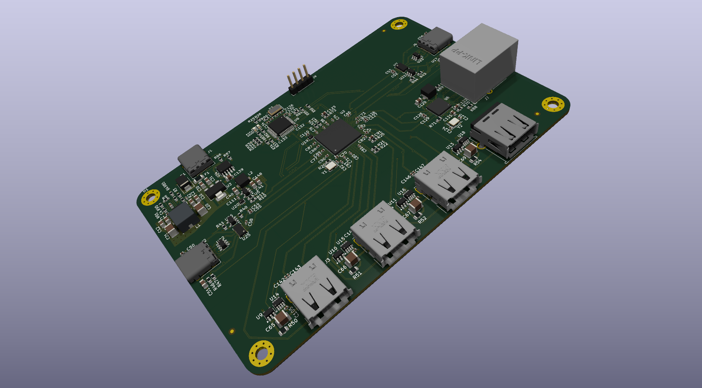
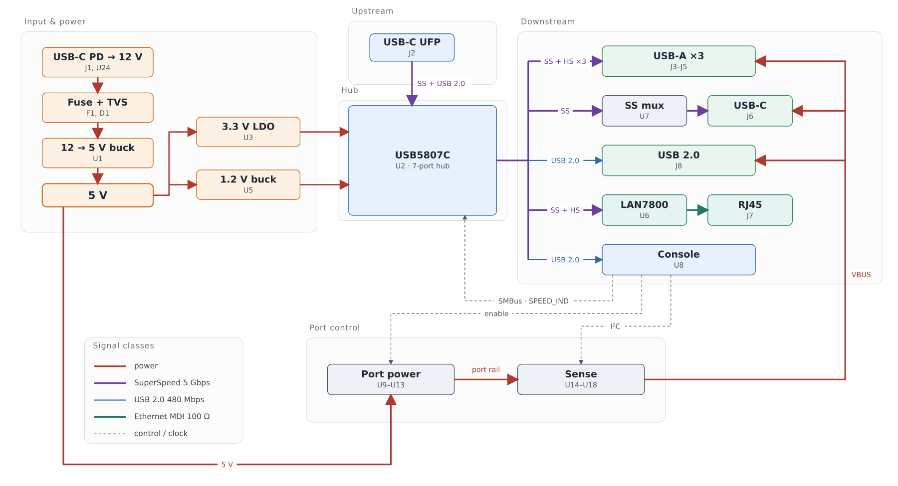
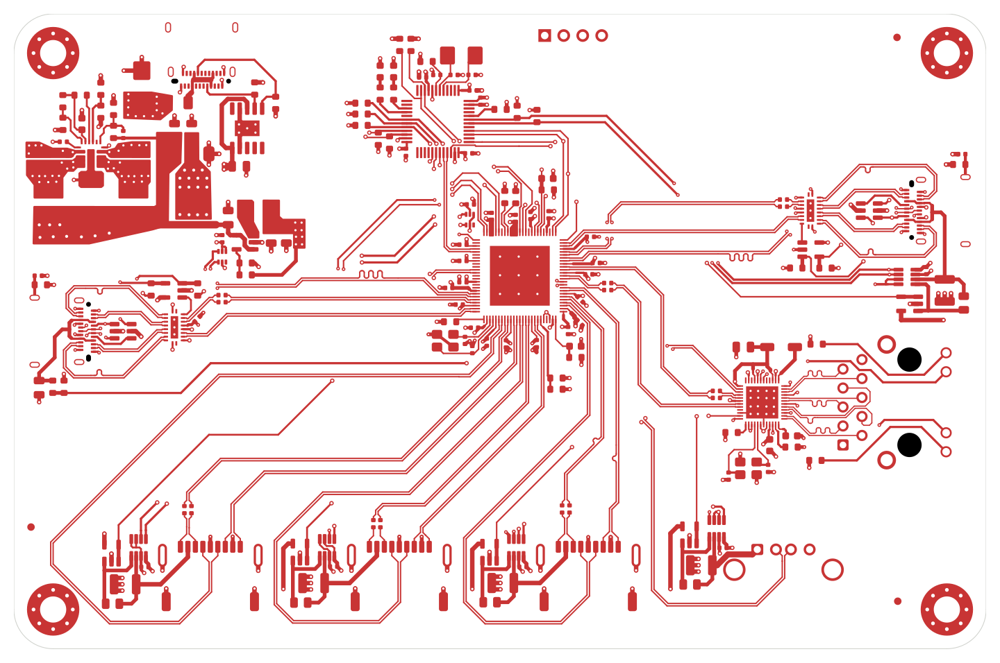
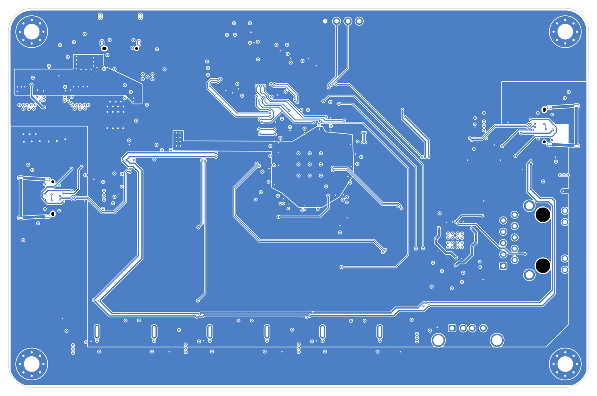
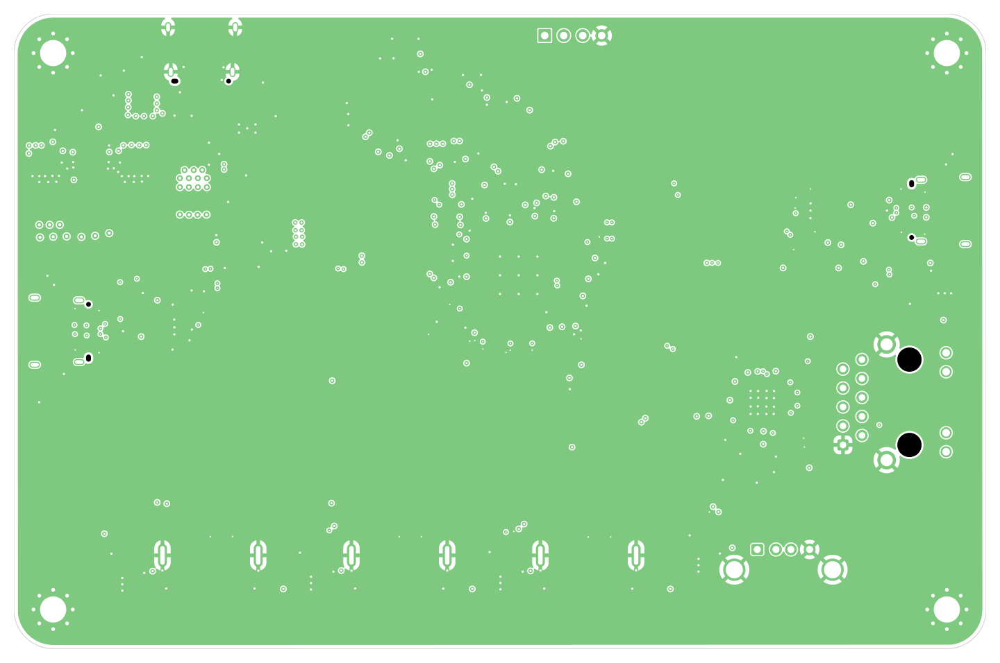
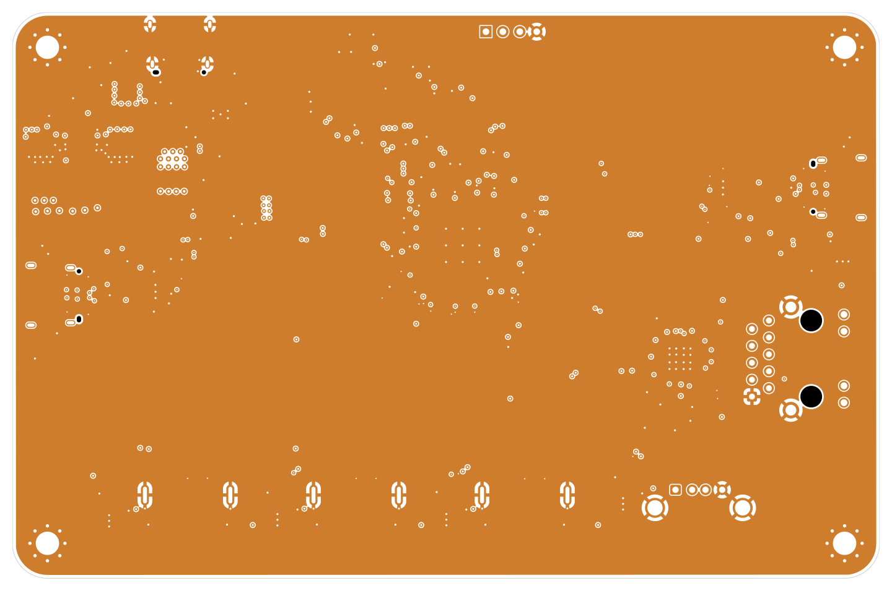

# USB-C Dock with Gigabit Ethernet — Rev A

A 130 × 85 mm, four-layer dock built around a 7-port USB 3.2 Gen 1 hub:
Gigabit Ethernet, three USB-A ports, a USB-C downstream port and a USB 2.0
port, with every external port measured and protected.



## Design viewer

| Schematic | Board |
|:---:|:---:|
| [Schematic, seven pages (PDF)](docs/renders/schematic-rev-a.pdf) | [Open the PCB in KiCanvas][kicanvas] |

The PCB opens in the browser viewer; the schematic is hierarchical — a root
sheet and six children — which KiCanvas does not traverse, so it is published
as one PDF instead.

[kicanvas]: https://kicanvas.org/?repo=https%3A%2F%2Fgithub.com%2FMehdi-Ldj%2Fusb3-dock%2Fblob%2Fmain%2Fhardware%2Frev-a%2Fusb3-dock.kicad_pcb

## Overview

Power and data arrive on **two separate USB-C ports**. `J1` is a USB-C PD input
that negotiates 12 V and feeds the converters; `J2` is the upstream port that
presents the dock to the host as USB 3.2 Gen 1 — SuperSpeed plus USB 2.0.

Three choices shaped the board more than anything else:

- **The channel is budgeted, not assumed.** Every SuperSpeed pair runs in a
  90 Ω class on the outer layers over a solid inner ground, and the whole path
  from hub pin to connector was cascaded against a 6.5 dB budget before layout.
- **Every port is measured.** Five INA219 sit on 0.1 Ω shunts, one per external
  port, sharing one bus with no mux, so a fault is a number rather than a guess.
- **Power is poured, not routed.** Both inner layers are ground so that *both*
  outer layers can carry controlled-impedance pairs; the 5 V rail is a pour on
  the bottom layer instead of a trunk of tracks.

## Features

- **7-port USB 3.2 Gen 1** hub (USB5807C), 5 Gbps per port
- **Gigabit Ethernet** via LAN7800 with an integrated PHY and an RJ45 magjack
- **USB-C PD input** (CH224A) negotiating 12 V
- 12 V → **5 V @ 6 A**, 3.3 V and 1.2 V local rails
- **Per-port measurement** — five INA219 on 0.1 Ω shunts, one bus, no mux
- **Per-port protection** — under 100 ms trip, latched, retried at 2 s / 10 s / 60 s
- SuperSpeed muxing to the USB-C port (HD3SS3212, 2:1)
- **130 × 85 mm, 4-layer**, controlled impedance on 26 differential pairs
- Thermal and ESD design for a self-powered dock: 5 V pour on B.Cu, TVS on the input

## Board specifications

| Item | Value |
|---|---|
| Board size | **130 × 85 mm**, 4 layers |
| Stackup | **JLC04161H-3313**, FR4, 1.6 mm nominal |
| Copper | 1 oz outer, 0.5 oz inner, ENIG finish, green mask, white silk |
| Reference planes | **L2 and L3, both solid ground**, unbroken under every pair |
| Minimum feature | 0.15 mm track, 0.11 mm clearance, 0.20 mm drill |
| Vias | 0.20/0.50 mm and 0.30/0.60 mm, tented, no blind or buried |
| Impedance | 90 Ω SS/HS, 100 Ω MDI, 50 Ω single-ended, all ±10 % |
| Assembly | JLCPCB Standard PCBA |

## Architecture



Line colour and weight separate the five signal classes: power, SuperSpeed,
USB 2.0, Ethernet MDI and control. The PD sink on `J1` produces the 12 V rail,
which is fused and clamped before the 5 V converter; the hub fans out to the
three USB-A ports, the USB-C port through the mux, the Ethernet bridge and the
USB 2.0 port. Port power and sensing sit below the hub, between the 5 V rail and
the five VBUS outputs: the switches gate each port, the shunts measure it, and
the console sets enables and reads the measurements over the control lines.

## Design notes

### SuperSpeed channel

Every SuperSpeed and USB 2.0 pair runs at 0.180/0.150 mm in its 90 Ω class on
L1 or L4, over a solid inner ground. The outer dielectric is 3313 prepreg,
which keeps a 90 Ω pair to 0.51 mm of width and lets the fan-outs fit under the
0.4 mm hub.

The channel is closed by analysis rather than by hope: trace, AC coupling,
vias, launches and the mux S-parameters cascade to **−2.58 dB at 2.5 GHz**
against a **6.5 dB** budget, with the mux contributing 0.85 dB of it. The
100 nF AC-coupling capacitors sit on the transmit side at the connector, where
the ESD diodes already are.

Because a 1.5 mm tuning meander cannot fit inside a 2.0 mm uncoupled window,
the allowance for uncoupled length is 3.0 mm, and the two runs that exceed it
are recorded rather than hidden.

### Power and thermals

The 12 V input is fused at 3 A and clamped by an SMBJ15A before the
TPS56C215 buck, which holds 5 V at 6 A. That converter was chosen on junction
temperature, not on current: 5 V at 6 A in a 3.5 × 3.5 mm QFN sits at roughly
94 °C junction at 40 °C ambient, and the 2 × 3 mm class was rejected on its
measured thermal resistance.

The 5 V rail is a pour on B.Cu rather than a trunk of tracks. That took the
drop at a fully loaded port from 231 mV to 27 mV and cut the copper loss from
about 750 mW to under 100 mW.

### Ethernet

The LAN7800 carries the MDI on a 100 Ω class to a magjack with integrated
magnetics and a Bob Smith termination, so no discrete transformer or common-mode
choke is needed. The MDI pairs are length-matched and stay on L1 for the whole
run.

### Port sensing and protection

Each external port has a TPS2065 switch and a 0.1 Ω shunt with an INA219 across
it, so current, voltage and power are measured rather than inferred. The hub's
port-power and overcurrent sense share one pin per port; the controller joins
that node with an open-drain pin, making it a wired-OR — either side can force a
port off, neither can force one on.

### Package and assembly

Four layers carry the 0.4 mm hub fan-out on the top, both inner layers as solid
ground, and the signal pairs on the bottom. The QFNs and the magjack have pads
underneath, so assembly is a stencil-and-reflow job rather than hand work; the
placement file carries the rotation corrections the assembler's part library
needs, measured once against their preview.

## Layout

| Front copper | Back copper |
|:---:|:---:|
|  |  |
| **Inner 1 — ground plane** | **Inner 2 — ground plane** |
|  |  |

Both inner layers are unbroken ground; the 5 V pour is the large region on the
back copper. The top view of the assembled board is
[`board-3d-top.png`](docs/renders/board-3d-top.png).

## Repository structure

| Path | Contents |
|---|---|
| `hardware/rev-a/` | KiCad 10 project: six schematic sheets, PCB, symbol and footprint libraries, 3D models, JLCPCB BOM |
| `docs/` | [BOM](docs/BOM.md), block diagram, board renders, schematic PDF |
| `LICENSE` | CERN Open Hardware Licence v2 — Permissive |

Open the project with KiCad 10:

```bash
kicad hardware/rev-a/usb3-dock.kicad_pro
```

## Fabrication and assembly

The board is drawn for JLCPCB 4-layer fabrication on the **JLC04161H-3313**
stackup with impedance control enabled at ±10 %, and for Standard PCBA with the
stencil and reflow that the QFN packages require.

The fabrication package for a release — gerbers, drill file, job file, BOM and
CPL — is attached to the release rather than committed here.

## Status

**Rev A is frozen and has not been fabricated yet.** The design is complete
through DRC, ERC and schematic/board parity.

## Licence

Released under the [CERN Open Hardware Licence Version 2 – Permissive](LICENSE).
